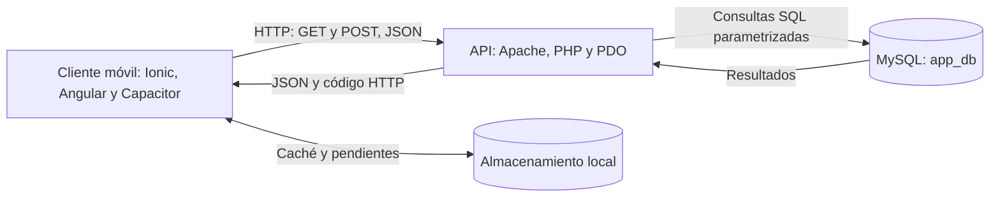

# Conversión de la aplicación en un cliente móvil conectado a un servicio web

**Proyecto:** Uma Musume Companion App.  
**Fecha:** 10 de octubre de 2026.  
**Tecnologías del proyecto:** Ionic, Angular, TypeScript, Capacitor, Axios, PHP, PDO y MySQL.

## 1. Objetivo y alcance

La aplicación funciona como cliente móvil: presenta el catálogo de Umas, permite registrar usuarios, iniciar sesión y enviar mensajes de contacto. El servicio web recibe peticiones HTTP, consulta o modifica MySQL y devuelve JSON. El dispositivo no ejecuta SQL ni se conecta directamente a la base de datos.

El proyecto ya contiene esta comunicación para catálogo, login, registro y contacto. Esta entrega documenta la arquitectura real y añade un servicio Angular tipado, preparado para consumir también detalle y compatibilidad. No se presenta un backend hipotético en Express: los endpoints existentes están escritos en PHP.

## 2. Diagrama Cliente → API → Base de datos

```text
CLIENTE MÓVIL                    API WEB                         BASE DE DATOS
Ionic + Angular                 Apache + PHP + PDO              MySQL: app_db
Empaquetado con Capacitor

Pantallas / servicios  ────────► api.php                 ──────► umas, aptitudes,
                       HTTP     login.php                SQL    afinidad_herencia,
                       + JSON   signup.php                      users, contactos
                       ◄─────── formulario-contacto.php ◄──────
                       JSON + código HTTP                Filas / confirmación

Caché local del catálogo
Imágenes en almacenamiento local
Cola local de contactos pendientes
```

Versión Mermaid para un visor compatible:



En desarrollo se usa HTTP en el puerto 8088. Para un despliegue público se propone HTTPS. MySQL usa el puerto 3307 en la configuración actual; el cliente solo conoce el puerto de la API.

## 3. Endpoints requeridos y métodos HTTP

**URL base local:** `http://localhost:8088/backend`. Las rutas siguientes son relativas a esa URL.

| Función | Método | Endpoint | Entrada | Éxito | Estado en la aplicación |
| --- | --- | --- | --- | --- | --- |
| Consultar catálogo | GET | `/api.php` | Sin cuerpo | 200: `status`, `total`, `data: Uma[]` | Consumido por `UmaService` |
| Consultar detalle | GET | `/api.php?id=1` | ID en query string | 200: `status`, `data: Uma` | Backend existente; preparado en `ApiService` |
| Consultar compatibilidad | GET | `/api.php?action=compatibility&id=1` | Acción e ID en query string | 200: `status`, `data: Compatibility[]` | Backend existente; preparado en `ApiService` |
| Iniciar sesión | POST | `/login.php` | JSON: `email`, `password` | 200: `status`, `message`, `user` | Consumido por Login |
| Registrar usuario | POST | `/signup.php` | JSON: `name`, `email`, `password` | 201: `status`, `message`, `user` | Consumido por Login |
| Enviar contacto | POST | `/formulario-contacto.php` | JSON: `nombre`, `apellido`, `email`, `mensaje` | 201: `status`, `message`, `id` | Consumido por Contacto |

- **GET:** consulta información; no requiere cuerpo JSON.
- **POST:** envía datos para verificar credenciales o crear registros. Se utiliza `Content-Type: application/json`.
- **OPTIONS:** permite la comprobación previa de CORS del navegador. El backend lo atiende con 200 sin cuerpo; no representa una operación de negocio.

No se requieren PUT, PATCH ni DELETE para estas funciones. El cambio de nombre del perfil y el cierre de sesión actuales son locales: no existe un endpoint que actualice el usuario ni uno que cierre una sesión de servidor.

| Código HTTP | Interpretación en los endpoints existentes |
| --- | --- |
| 200 | Consulta o login correctos |
| 201 | Registro de usuario o contacto creado |
| 400 | Campos faltantes, correo inválido en registro o compatibilidad sin ID |
| 401 | Credenciales incorrectas |
| 404 | Uma no encontrada en consulta de detalle |
| 405 | Método no permitido en catálogo, login y registro |
| 409 | Correo ya registrado |
| 500 | Fallo del backend o base de datos |

Contacto todavía no rechaza explícitamente métodos distintos de POST y OPTIONS. Se propone añadir ese control. El servicio nuevo valida IDs enteros positivos para evitar que PHP interprete un ID cero como consulta de listado.

## 4. Modelo JSON de intercambio

Los siguientes ejemplos ilustran el contrato; los nombres, IDs y estadísticas son datos de ejemplo, no resultados obtenidos de una API en ejecución.

### Catálogo: respuesta a GET /api.php

```json
{
  "status": "success",
  "total": 1,
  "data": [
    {
      "id": 1,
      "name": "Uma de ejemplo",
      "rarity": 3,
      "imageUrl": "http://localhost:8088/backend/public/images/ejemplo.png",
      "baseStats": { "speed": 100, "stamina": 90, "power": 95, "guts": 80, "wit": 85 },
      "maxStats": { "speed": 120, "stamina": 110, "power": 115, "guts": 100, "wit": null },
      "growthRates": { "speed": 20, "stamina": 0, "power": 10, "guts": 0, "wit": 0 },
      "aptitudes": {
        "turf": "A", "dirt": "B", "short": "C", "mile": "A", "medium": "A",
        "long": "B", "front": "C", "leader": "A", "betweener": "A", "chaser": "B"
      }
    }
  ]
}
```

El detalle usa `data` con un solo objeto del mismo modelo, sin `total`. Un catálogo vacío válido usa `total: 0` y `data: []`. Las estadísticas máximas ausentes llegan como `null`. Cambiar entre estadísticas base y máximas no necesita otra petición porque ambas están en el catálogo.

### Compatibilidad: respuesta

```json
{
  "status": "success",
  "data": [
    { "id": 2, "nombre": "Otra Uma", "imagen_url": "http://localhost:8088/backend/public/images/otra.png", "puntos_compatibilidad": 25 }
  ]
}
```

Este endpoint conserva nombres distintos del catálogo. Sus IDs y puntos pueden llegar como números o cadenas según PDO; el servicio contempla ambos tipos.

### Login y registro: solicitudes

Login:

```json
{ "email": "ana@example.com", "password": "ClaveDeEjemplo123!" }
```

Registro:

```json
{ "name": "Ana", "email": "ana@example.com", "password": "ClaveDeEjemplo123!" }
```

Respuesta de login:

```json
{
  "status": "success",
  "message": "¡Inicio de sesión exitoso!",
  "user": { "id": 1, "name": "Ana", "email": "ana@example.com" }
}
```

Registro devuelve las mismas propiedades, con un mensaje de cuenta creada y un código 201. Su ID puede ser una cadena, por ejemplo `"1"`, porque PHP usa `lastInsertId()`. Ninguna respuesta devuelve la contraseña ni su hash. El backend actual no devuelve un token.

### Contacto: solicitud y respuesta

```json
{ "nombre": "Ana", "apellido": "López", "email": "ana@example.com", "mensaje": "Me gustaría consultar información del catálogo." }
```

```json
{ "status": "success", "message": "¡Mensaje de contacto enviado con éxito!", "id": "15" }
```

El mensaje se guarda en MySQL; este endpoint no envía correos. La fecha y la marca de revisión de la cola offline son metadatos locales y no se envían.

### Error: ejemplo de credenciales incorrectas

```json
{ "status": "error", "message": "Correo o contraseña incorrectos." }
```

El código HTTP acompaña al JSON: en este caso es 401. Un fallo de red o timeout puede no contener un cuerpo JSON, por lo que también debe manejarse en el cliente.

## 5. Servicio Angular preparado para consumir la API

Código entregado: [api.service.ts](../src/app/services/api.service.ts). Es un servicio `@Injectable({ providedIn: 'root' })` que utiliza Axios, la biblioteca que ya emplea la aplicación. Angular no exige usar HttpClient para que una clase sea un servicio.

| Método TypeScript | Operación HTTP |
| --- | --- |
| `getUmas()` | GET catálogo |
| `getUma(id)` | GET detalle |
| `getCompatibility(id)` | GET compatibilidad |
| `login(input)` | POST credenciales |
| `signup(input)` | POST registro |
| `sendContact(input)` | POST contacto |

Incluye interfaces para entradas y respuestas, URL compartida mediante `getApiBaseUrl()`, encabezados JSON, timeout de 10 segundos, validación de IDs y conversión de errores a mensajes mediante `dataErrorMessage()`. Comprueba `status: success`, pero las interfaces TypeScript no validan toda la estructura JSON en ejecución. No reintenta automáticamente operaciones POST.

Ejemplo de consumo dentro de una página Angular:

```ts
import { inject } from '@angular/core';
import { ApiService } from '../services/api.service';
import { Uma } from '../models/uma.model';
import { dataErrorMessage } from '../services/data-error';

// Miembros de la clase de la página:
private readonly api = inject(ApiService);
umas: Uma[] = [];
error = '';

async cargarCatalogo(): Promise<void> {
  this.error = '';
  try {
    const response = await this.api.getUmas();
    this.umas = response.data;
  } catch (error: unknown) {
    this.error = dataErrorMessage(error);
  }
}
```

**Alcance de integración:** el nuevo servicio queda preparado, con pruebas unitarias añadidas y comprobación TypeScript correcta. La ejecución de esas pruebas no pudo completarse por un fallo del proceso de Vitest, detallado abajo. Las pantallas existentes siguen usando `UmaService` y las llamadas de Login/Contacto. El catálogo actual conserva validación de datos, caché e imágenes sin conexión; el ejemplo anterior solo demuestra consumo HTTP. Como siguiente refactor se propone delegar el transporte de esas clases a `ApiService`, manteniendo sus políticas offline y sus pruebas.

## 6. Explicación de la arquitectura propuesta

La arquitectura tiene tres capas. El **cliente móvil** presenta formularios y catálogo, gestiona navegación y muestra carga, errores y datos guardados. Ionic proporciona componentes de interfaz, Angular organiza páginas y servicios, y Capacitor permite empaquetar la aplicación para Android. La caché mejora la disponibilidad, pero MySQL sigue siendo la fuente de los datos del servidor.

La **API web** recibe entradas, aplica validaciones y reglas, ejecuta consultas mediante PDO y transforma filas de MySQL a JSON. Por ejemplo, `formatUma()` convierte `nombre` en `name` y agrupa columnas de estadísticas en `baseStats` y `maxStats`. Esa transformación permite separar el esquema SQL del modelo que presenta Angular.

La **base de datos** persiste usuarios, catálogo, aptitudes, afinidades y contactos. Solo PHP accede a ella. Las contraseñas se almacenan con `password_hash()` y se comprueban con `password_verify()`. Las operaciones usan consultas preparadas para los parámetros recibidos.

Flujo de lectura: la pantalla solicita el catálogo → el servicio realiza GET → PHP consulta MySQL → PHP devuelve JSON → Angular muestra las tarjetas y el servicio existente conserva una copia válida. Si falla la red o el servidor, se puede mostrar esa copia indicando su procedencia.

Flujo de escritura: el usuario completa Contacto → el cliente valida el formulario → realiza POST → PHP valida campos e inserta → devuelve 201 y el ID. Sin red, la implementación existente conserva el mensaje en una cola local. Solo elimina pendientes tras confirmar éxito; los envíos ambiguos quedan para revisión.

### Preparación de la conexión móvil

1. Configurar Apache para servir `backend` en el puerto 8088 y arrancar MySQL con la base `app_db`.
2. Verificar las tablas requeridas. **El `schema.sql` incluido solo crea `users` y `products`; no basta para reconstruir el catálogo.** Para una instalación limpia deben aportarse el esquema y los datos de `umas`, `aptitudes` y `afinidad_herencia`. `contactos` se crea actualmente desde su endpoint.
3. Revisar `src/app/services/api.config.ts`. En Android por USB, la configuración actual utiliza `adb reverse tcp:8088 tcp:8088`. Sin redirección, `localhost` apunta al teléfono.
4. Para otra red o un servidor público, configurar una URL accesible desde el dispositivo; en producción se propone HTTPS. Las credenciales SQL permanecen en el servidor.
5. Consultar `/api.php` y comprobar luego login, registro y contacto con datos de prueba. Estas verificaciones de servidor y dispositivo deben hacerse con los servicios activos.

### Mejoras propuestas y su justificación

| Hallazgo | Mejora propuesta | Beneficio |
| --- | --- | --- |
| Peticiones distribuidas entre servicios y páginas | Migrar gradualmente el transporte a `ApiService` | Centralizar contratos y configuración sin perder la política offline |
| Usuario guardado localmente usado como control de navegación | Implementar sesión o token validado por el servidor para recursos privados | El servidor verifica identidad y permisos; el guard local no proporciona autorización |
| Un POST puede guardarse aunque su respuesta se pierda | Añadir un ID de operación único y deduplicación transaccional en contacto | Reintentar sin crear mensajes duplicados |
| Contratos con `user`/`data` y nombres diferentes | Normalizar contratos en una futura versión de API | Simplificar el consumo sin cambiar silenciosamente el contrato existente |
| Esquema SQL incompleto para el catálogo | Añadir migraciones y datos iniciales reproducibles | Instalar el backend desde cero |
| Tipos estáticos sin validación completa de respuesta | Validar todos los campos usados por la vista antes de aceptarlos | Evitar que una respuesta malformada llegue a la interfaz |
| Contacto no restringe explícitamente métodos ni valida formato de correo en PHP | Exigir POST y validar correo, tamaños y contenido en el servidor | Reforzar el contrato independientemente del cliente |
| Errores PHP incluyen detalles internos de PDO | Registrar detalles en el servidor y devolver mensajes genéricos | Evitar exposición de información interna |

Estas mejoras son propuestas; salvo el servicio preparado y sus pruebas, no se han implementado en esta entrega.

## 7. Evidencia de uso de IA para analizar y mejorar la arquitectura

**Asistente:** Codex. **Fecha:** 10 de octubre de 2026.

**Solicitud real del usuario, extracto:** «Convertir la aplicación en un cliente móvil conectado a un servicio web» y entregar diagrama, endpoints, métodos HTTP, JSON, servicio Angular, arquitectura y evidencia de IA.

**Análisis realizado por IA en esta sesión:** lectura del código de catálogo, login, registro, contacto, modelos Angular, configuración y esquema SQL; comparación de las rutas documentadas con las implementaciones PHP; revisión de la caché y de los contratos de intercambio.

| Evidencia encontrada | Resultado del análisis asistido |
| --- | --- |
| [api.php](../backend/api.php) transforma filas con `formatUma()` | Documentar el modelo JSON real y distinguir listado, detalle y compatibilidad |
| [login.php](../backend/login.php) devuelve `user`, sin sesión ni token | Separar login local de una futura autorización en servidor |
| [tab2.page.ts](../src/app/tab2/tab2.page.ts) marca envíos ambiguos | Proponer deduplicación en servidor y evitar reintentos POST automáticos en el nuevo servicio |
| [schema.sql](../backend/schema.sql) carece de tablas del catálogo | Señalar el requisito para una instalación reproducible |
| [api.service.ts](../src/app/services/api.service.ts) añadido en esta sesión | Entregar transporte HTTP tipado para los seis endpoints |
| [api.service.spec.ts](../src/app/services/api.service.spec.ts) añadido en esta sesión | Verificar rutas, parámetros, cuerpos, IDs inválidos y errores con HTTP simulado |

Este documento y los archivos enlazados son evidencia del trabajo asistido. La conversación original puede adjuntarse como evidencia adicional si la rúbrica pide capturas. No se atribuyen a esta sesión desarrollos históricos ni decisiones de aprobación humana que no constan. La bitácora histórica independiente está en [BITACORA_IA.md](BITACORA_IA.md).

### Verificación de esta entrega

Comprobaciones ejecutadas durante esta sesión:

| Comando desde `project01` | Resultado |
| --- | --- |
| `node node_modules/typescript/bin/tsc --noEmit -p tsconfig.app.json` | Correcto, código de salida 0 |
| `node node_modules/typescript/bin/tsc --noEmit -p tsconfig.spec.json` | Correcto, código de salida 0; incluye el nuevo servicio y sus pruebas |
| `node node_modules/@angular/cli/bin/ng.js test --watch=false` en entorno restringido | No pudo iniciar esbuild: `spawn EPERM` |
| Mismo comando con permisos adicionales | Compilación correcta; Vitest inició y terminó con `Worker exited unexpectedly`, código de salida 1; sin resultados de pruebas |

No se afirma que las pruebas unitarias hayan pasado. Deben repetirse en un entorno donde Vitest pueda completar sus procesos. Las pruebas HTTP simuladas no demuestran por sí mismas conexión a Apache, MySQL o un teléfono físico. No se ejecutaron pruebas contra el backend ni en un dispositivo durante esta sesión.
